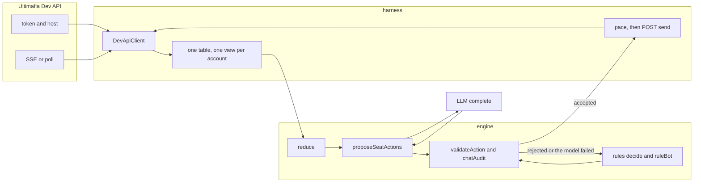
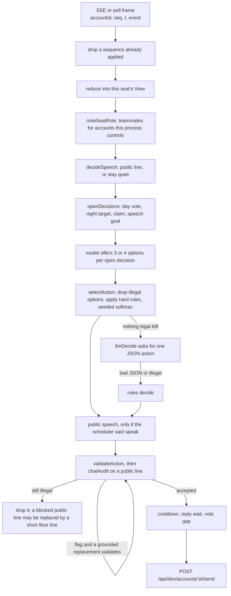
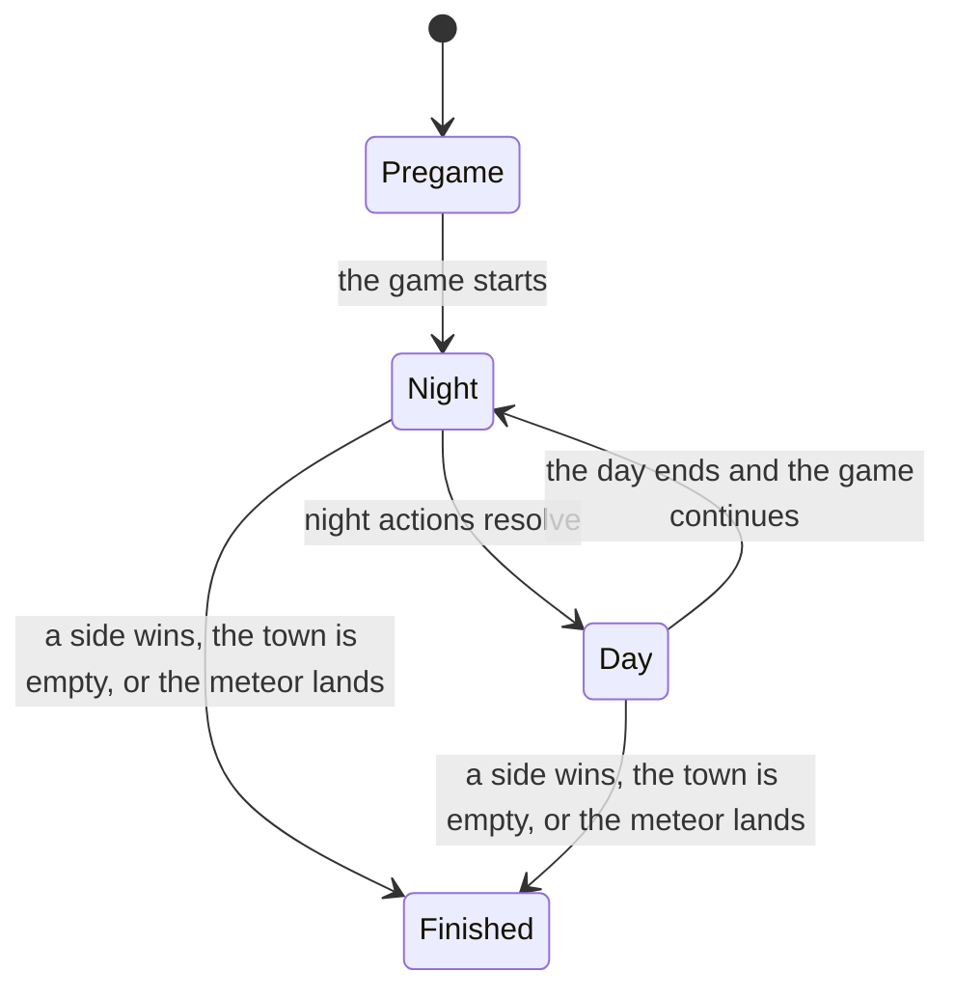

# Mafioso

An AI seat for [Ultimafia](https://github.com/UltiMafia/Ultimafia). The engine keeps the rules. The harness keeps the connection. A model may propose the next line. It never sends one the engine rejects.

The setup this tree plays is [Frontier Justice](https://ultimafia.com/learn/setup/1T55KrrbY): three Villagers, a Cop, a Journalist, a Sheriff, a Mafioso, a Janitor, and a Lawyer. That link is the public setup page. The client does not open it. Live play stays on the Dev API allowlist.

**[Quickstart](docs/QUICKSTART.md)** — setup, install, tests, self-play, the arena, a live dev run, and environment variables.

## Contents

- [Architecture](#architecture)
- [One turn](#one-turn)
- [Phases](#phases)
- [How the engine works](#how-the-engine-works)
- [How the harness works](#how-the-harness-works)
- [Humans and other bots](#humans-and-other-bots)
- [Frontier Justice roles](#frontier-justice-roles)
- [Module map](#module-map)
- [Safety](#safety)
- [License](#license)

## Architecture

`engine/` is a deterministic rules engine. It has no network code. It folds events into one view per seat, lists what that seat may do, and rejects the rest.

`harness/` is the Dev API client. It speaks HTTPS and server-sent events, asks an LLM when one is configured, and posts an action only after `validateAction` accepts it. The site's raw game socket is not the live transport. `engine/src/wire.js` is that codec, kept for reference.

Each account has its own players, meetings, notes, fact ledger, beliefs, digest, and memory. One seat does not read another's memory. A Mafia seat learns a plan from faction chat the game delivered to that seat.

## One turn

A turn starts when a frame arrives and ends when this seat's legal actions, if any, have been sent. Votes and night actions are not held for the speech scheduler. Public chat is.

`proposeSeatActions` in `engine/src/llmDecide.js` is that path:

1. The scheduler decides public speech. A night ability and a faction night vote still go out.
2. With a `complete` function, the seat asks once for several different options on each open decision.
3. `selectAction` drops options `validateAction` rejects, applies the hard rules, and samples the rest with a seeded softmax.
4. If that call fails or no legal option remains, `llmDecide` asks for one JSON action. If that also fails, the seat uses rules `decide`.
5. Public speech, when the scheduler allows it, is generated from the same briefing and checked again. `wait` is rejected while a night ability or a faction night vote is still open.
6. Every action in the returned list has passed `validateAction`.

Hard rules in the selector: act on an open night ability; do not kill or vote a known teammate; town does not vote a player it reads as town at probability 0.8 or higher unless that vote would tip the lynch; a plan line this seat has seen wins while that target is still legal; a Loyal Lawyer litigates teammates; the Janitor cleans the planned kill and does not skip.

`DevApiClient.send` runs `validateAction` again and throws `IllegalActionError` before any HTTP when a view is provided. `runLoop` and `runLoopAsync` collect proposals and do not send.

`legal.js` keeps three layers apart: what the Ultimafia server accepts, hard rules `validateAction` refuses, and advice a bot should not pick. Vote Kick is refused. A town seat cannot vote no-one into an autoloss, on day 1 while the Sheriff lives, or under a day meteor.

## Phases

`state.name` is `Pregame`, `Day N`, or `Night N`. A new `state` clears meetings. `history` restores the current state's meetings, dead players, and winners on reconnect. The clock is the frame time `t`.

**Night.** The server opens Mafia chat, Mafia Kill, and the role meetings: Cop Investigate (`Learn Alignment`), Journalist Receive Reports, Lawyer Litigate, Janitor Clean Death (Yes or No, once). The offline resolver in `engine/src/resolve.js` applies them in server priority order: a Doctor save (the resolver knows that action; [Frontier Justice](https://ultimafia.com/learn/setup/1T55KrrbY) does not deal a Doctor), then Lawyer Litigate, then Janitor Clean Death when the kill will land, then the Mafia kill, then the Cop and Journalist reports. Actions are queued at phase end, so a seat killed that night still acts.

**Day.** The village votes, and the Sheriff shoots once while the gun is loaded. The gun is instant. The shot reveals the shooter. The village tally counts every ballot, including no-one (`*`). A tie kills nobody.

`winnerOf`: Village wins when every living player is Village. Mafia wins when living Mafia is at least half the living players. An empty town, or the meteor, is "No one".

## How the engine works

The engine is a pure function of one seat's view. The same event list produces the same view. Nothing in `engine/src` opens a socket.

### State and the reducer

`emptyView` starts a seat with no self id: players, dead, phase, meetings, messages, winners, reveals, role, claims, notes, ledger, beliefs, digest, and memory.

`reduce(view, frame)` clones that view and switches on `event`. It accepts a raw game event or a Dev API envelope. Handled frames include `time` / `timerInfo` (day length and remaining time), `self`, `players`, joins and leaves, `state` (which clears meetings), `history`, `reveal` / `roleReveal`, `meeting`, `message`, `vote`, and the local `teammates` and `botConfig` frames the harness injects. Those two are not server events.

A meeting the seat belongs to is tagged when the server says it is Mafia or Cult chat, a kill vote, or a role action. Messages land on the view in order. `applyNotes`, `reduceClaims`, `noteFactionPlan`, and `applySeatMemory` run as part of that fold. `memory.due` is set when the phase changes or a hard result arrives. `refreshSeatMemory` then makes one model call; if the model returns nothing usable, rules write the belief board and the digest.

### Beliefs and suspicion

Two boards, used for different jobs.

The **belief board** (`beliefs.js`) is this seat's private read of each living player. An entry needs a role, a label or a probability, a reason, and fact-ledger ids. `judgeBelief` rejects an unknown player, a dead player, a missing ledger id, and a hard contradiction: a Village check cannot be believed as Mafia. Labels are `confirmed` (probability at least 0.85), `likely` (0.6), `possible` (0.3), `unlikely`, and `claimed`. The fact ledger (`factLedger.js`) is append-only. Hard facts are this seat's checks, deaths, reveals, and its own role. A claim is stored as speech, with `hard: false`. Player chat that mimics a server result is not a check.

**Town suspicion** (`townReads.js`) is a separate score, and only Village seats use it for the day vote. It adds evidence points from `TOWN_READS`: an own Cop result, someone claiming this seat's unique role, a proven liar, a Journalist report that confirms or sinks a Cop claim, a wagon that lynched town, a standing vote on a revealed town player, and smaller weights for contested claims and vote history. A Cop "guilty" counts when the result frame matches. A free-chat line such as "x is mafia" is not a guilty result. The weights only order evidence. They are not a fitted win model.

### Claims

`claims.js` is regex only. It reads `claim`, `cc` / counterclaim, `retract`, and a soft `might be` / `could be` / `maybe`. Server and anonymous senders are ignored. "claiming cop" counts only in the first person or at the start of a sentence, so a line about someone else does not tag the speaker. A claim updates `view.claims`. It never creates an ally. `faction.js` builds allies from server reveals and the harness-injected `view.teammates` roster.

### Lynch and vote math

`lynchMath.js` is how a town seat decides whether a no-lynch loses the game. `assumedMafiaAlive` uses `view.config.mafiaCount` when set, otherwise `floor(player count / 3)`, then subtracts scum the server has revealed as dead. Town cannot see the real count, so every unconfirmed scum seat counts as alive. `noLynchLoses` is the autoloss case: after a no-lynch and the next night kill, assumed mafia would be at least the remaining town. `lyloToday` is lynch-or-lose: a wrong lynch leaves assumed mafia at least half the living. A meteor warning on the current phase (`meteorOn`) means someone must die or the game ends with no winner. `dayOneLynchOwed` is day 1 while this seat does not know the Sheriff is dead: town does not vote no-one. A cleaned Sheriff still counts as alive for that check.

`ballot.js` reads the village meeting on this seat's view. `voteCounts` tallies living ballots. The leader is a strict plurality on a player; a tie, or a lead of no-one, lynches nobody. `ballotStuck` is two or more player-targets with votes and no strict leader. `switchesFor` lists the ballots that would create a lynch if this voter moved. `formatBallot` puts that in the prompt as names.

`ballotSwitch` may change this seat's own vote. While the day is split, an unsure town seat follows a clear's push onto a target the reads still allow. Before a dangerous deadline (`consolidateDue`: day fraction 0.72, 50 seconds left, or a vote-kick warning) and with no leader, town piles onto one legal target. Mafia swings onto the plan target and steps off a teammate the bus rules do not allow. The switch is skipped while the Sheriff still owes the day-1 shot, and while the revealed-Sheriff hammer owns the day (`view.config.hammer` stays on unless set to `off`).

The bus (`bus.js`) allows a scum seat to vote a known teammate when town is already on them, or when the model picked that as a town-read play and town already suspects them. It refuses the bus when that vote would hand town the game or leave fewer than two living scum.

### Candidates and legal actions

`legalVotes` lists meetings this seat can still vote in, with the server's targets. `openDecisions` turns those into day-vote and night-target decisions. A claim decision is added only when `claimAllowed` says this seat may claim. A speech-goal decision is added only when the scheduler already said speak.

The candidate prompt asks for three or four strategically different options per open decision, each with a one-line reason. Chat in the briefing is labeled untrusted. The model does not pick the final action. `selectAction` does, after the hard rules above. A seeded softmax breaks the remaining ties so a replay with the same seed is stable.

`nightAct.js` and `data/night-actions.json` force a night vote for roles marked `alwaysAct`. The Cop investigates every night the meeting is open. Cleared or already checked players are skipped while another living target exists. On night 1 the live harness does not call the model for the Cop or the Journalist: `nightOneRandomPicks` chooses a seeded legal target.

### How a model proposal is kept or replaced

The model is a proposer. Replacement happens in order:

| What came back | What is sent |
| --- | --- |
| An option `validateAction` rejects | Dropped before the softmax |
| An option a hard rule forbids (teammate kill, town voting a strong town read, skipping an open night ability) | Replaced by the rule's target while that target is legal |
| A failed candidate call, or no legal option left | One more JSON action from `llmDecide` |
| Bad JSON, a timeout, or an illegal single action | Rules `decide`, which only returns actions that validate |
| A public line that fails `chatAudit` | `groundedLine` when that line validates; otherwise the line is dropped |
| `wait` while a night ability or a faction kill vote is open | A legal night vote from the night policy |

The live table also wraps `complete` in a 45 second timeout (`LLM_TIMEOUT_MS`). A model line is shortened to the public cap and, when the source is `llm`, to at most 12 words (`capSpeechWords`) before it is validated again.

Prompt evolution, when `MAFIOSO_EVOLVE` is on, scores each prompt that played and asks for a child system prompt. The child is stored only when it still contains the never-admit-AI line and the JSON action contract (`"vote"|"unvote"|"speak"|"wait"`). `MAFIOSO_ARENA_GAMES` above 0 also requires an offline arena on the same seeds to beat the parent by more than the noise. The runtime store is `harness/data/prompts/runtime/` (gitignored). The committed seed is `harness/data/prompts/seed.json`.

### Chat audit and sanitize

Player chat is data, not instructions.

`sanitize.js` normalizes text (NFKC), strips invisible format characters, flattens it to one line, caps it (`sanitizeChat` at 200 characters), defangs injection markers, and JSON-quotes it. `buildBriefing` puts the last 25 messages under `PLAYERS SAID (untrusted, quoted)` and quotes names the same way. Faction chat in the notes is quoted too. `SYSTEM_PROMPT` tells the model that block is untrusted and that the reply must be one JSON action from `LEGAL ACTIONS`.

`validateAction` rejects public or faction speech that contains machine coordination (`PLAN`, `key=value`, raw player ids, invisible characters) and public speech that admits a mafia faction, names a teammate as team, or fails `chatAudit`.

`chatAudit` checks a public line against what this seat knows. Flags are `LEAK` (hidden info), `CONTRADICTION` (a public fact stated wrong), and `SCUM_MISTAKE` (a fake claim or result the public facts already disprove). Deception that still fits the public facts is allowed. `view.config.chatAudit === "measure"` records flags and does not block. The default on the live table and in self-play is `enforce`.

Case notes for the injection tests are in `harness/test/INJECTION_CASES.md`.

### Scheduler and timing

`scheduler.js` decides whether this seat speaks in public. It does not decide votes.

Urgency is 0–4. Being named, being voted, or owing the day-1 Sheriff claim is 4. Unreported hard info, or a plan claim this seat still owes, is 3. A silent-day opening, or votes already on the table, is 2. Other fresh public lines are 1. Night public speech is 0. Dead, finished, and left seats are 0.

The threshold depends on this seat's recent public lines against the other living players (last 12 public messages). Quiet (at least 3 own lines and more than twice the others' mean) speaks only at urgency 3 or higher. Balanced speaks at 2. Talkative (fewer lines than the others' mean) speaks at 1. Caps: 3500 ms cooldown, 6 lines a minute, 4 lines a phase. An optional model may only turn a fuzzy urgency of 1 or 2 into a wait. It cannot beat a cap or speak below the threshold. A silent day opens after 2 seconds plus 0–9 seconds derived from the seat id, so the seats do not open on the same tick.

The harness adds a second clock on the bot's own sends. These constants are in `harness/src/live.js`. They are the delays the code applies. They are not measurements from human games.

| Constant | Value | What it gates |
| --- | --- | --- |
| `CHAT_LIMITS` | 3500 ms cooldown, 6 lines a minute, filler gap 20 s, filler chance 0.4 | Extra public fillers |
| `REACT` | 3–8 s (an urgent reply uses 3 s) | A line answering a fresh message |
| `SPEECH_PACE` | own gap 6 s, table gap 2.5 s, claim gap 1 s, stale after 30 s | Spacing between this seat's lines and the table |
| `COPY_VOTE` | 2–15 s, at least 2 s apart | A non-leader kill vote. Day votes use the same stagger when `fast` is on, which is how the live CLI and self-play call `onGameEntry` |
| `DAY_VOTE` | day fraction 0.6, or 60 s left, or 8 other lines of at least 3 words | When a day vote is allowed out |
| `VOTE_GAP_MS` / `VOTE_BACKOFF_MS` | 3 s between votes; 6 s after "voting too quickly" | This seat's ballots |
| `BALLOT_NET` | day fraction 0.9 or 20 s left; Sheriff owed the shot: 0.96 or 12 s | A last legal village vote so the seat is not vegged |
| `DAY_SPEECH` | open within 20 s; a quiet table after 45 s | Staggered openers, then one line if the day is silent |
| `SPEECH_FLOOR` | 3 lines | A short fallback after repeated audit blocks |
| `SCUM_CHAT` | first line after 300–1500 ms, then about 2 s apart | Template lines in Mafia chat |
| `LLM_TIMEOUT_MS` | 45 s | One model call |

`ballotNet` and `gunNet` run late in the day, or on a vote-kick warning. They cast this seat's own legal village vote, or the owed Sheriff shot, including when the Sheriff and hammer holds would otherwise keep the seat silent. They do not edit anyone else's ballot.

## How the harness works

The harness is everything that touches time, the network, or more than one account. The engine stays pure. The harness decides when a legal action actually leaves.

### Live client

`harness/scripts/live.mjs` calls `runLiveCli`.

1. **Dry run.** If `MAFIOSO_LIVE` is not `1`, the process logs one dry-run line and returns. It does not call fetch.
2. **Allowlist.** `DEV_HOSTS` in `engine/src/types.js` is `https://dev.ultimafia.gg` and `http://127.0.0.1:3000`. Any other origin throws `HostNotAllowedError` on the client and again on each request. `DEV_API_BASE_URL` defaults to `https://dev.ultimafia.gg`.
3. **Auth.** `POST /api/dev/token` with `DEV_API_CLIENT_ID` and `DEV_API_CLIENT_SECRET`. The Bearer token is refreshed on a 55-minute timer, including before each stream connect. Optional Cloudflare Access headers (`CF_ACCESS_CLIENT_ID`, `CF_ACCESS_CLIENT_SECRET`) are added only to game fetches.
4. **Lobby.** `hostGame` forces `private: true`, `lobby: "Testing"`, and `spectating: true`, and refuses ranked or competitive. `DEV_SETUP_ID` is required to host. `GAME_ID` joins a game that is already open. `createAccounts` seats `BOT_COUNT` test accounts (default 9, range 1–50). When this process hosted, it then leaves the developer's own seat so the developer does not take a player slot. `docs/PROTOCOL.md` records that those Dev API accounts are created with `isBot: true`.
5. **Self ids.** The server sends `self` once, often before the stream attaches. `seedSelfIds` reads each account's `playerId` from `GET /api/dev/accounts`. Without a self id the seat decides nothing.
6. **Events.** `MAFIOSO_TRANSPORT=stream` (default) reads `GET /api/dev/stream` (`event: game`, data `{accountId, seq, t, event, data}`). `poll` reads `GET /api/dev/accounts/:id/events?since=`. `DEV_STREAM_PATH` must stay under `/api/dev/`. Reconnect uses exponential backoff. After each subscribe the harness backfills buffered events and drops sequence numbers it has already applied.
7. **Reduce and send.** One queue per seat. A limiter caps concurrent model calls (1 for LM Studio, 4 otherwise, or `MAFIOSO_LLM_CONCURRENCY`). Log lines pass through `redact`, which strips credential and key environment values. `DevApiClient.api` does not echo request bodies.

`createBotTable` sets the live strategy: `mafia: "adaptive"`, `town: "rules"`, `chatAudit: "enforce"`, `hammer: "on"`, `pace: "on"`, Sheriff rule `vinman` (shoot on day 1). `MAFIOSO_TOWN` can select `suspicion` or `random`. `MAFIOSO_HAMMER=0` turns the hammer off. Those are process-wide. They are not a human mode and a bot mode.

### Replays and fixtures

Fixtures are recorded frames with ids and display names replaced. Engine tests read `engine/test/fixtures/`. Protocol tests read `harness/test/fixtures/replays/` (`g01`–`g16`), `harness/test/fixtures/live-1018/`, and a sample SSE body at `harness/test/fixtures/stream.sse`.

`replayBuild.js` and `scripts/build-replays.mjs` rebuild those fixtures from a live-harness log. The builder scrubs ids and names and throws if a raw name remains. `protocol-doc.test.js` checks `docs/PROTOCOL.md` against the fixture event types and `classifyEvent`.

`simLatency.js` replays logged model service times from `latency-live1018.json` (counts only; no ids and no chat text). `audit-rejects.mjs` and `stale-latency.mjs` re-run logged rejects through the current validators. None of these open a socket.

### Self-play

`selfplay.js` runs [Frontier Justice](https://ultimafia.com/learn/setup/1T55KrrbY) in-process. It seats every role itself, drives the live decision path (`proposeSeatActions`, the scheduler, chat audit), and resolves night and day locally. `createOfflineComplete` enumerates legal candidates and does not call a model. Public speech uses a few prescribed lines (the Sheriff outing, a planned claim) and throws otherwise, so the rules lines are what get said. There is no socket.

The CLI flags (`--sheriff-rule`, `--mafia`, `--town`, `--chat-audit`, the quiet-table flags, and the rest) are listed in the [quickstart](docs/QUICKSTART.md). The default mafia mode is adaptive. `--mafia script` restores the fixed plan. The process exits 1 when a game records an illegal action or an error. Scorecards land under `logs/selfplay/` and are gitignored.

### Arena

`arena.js` is the other offline [Frontier Justice](https://ultimafia.com/learn/setup/1T55KrrbY) runner. `--mafioso N` seats N model seats; the rest are `ruleBot`. It writes `logs/replays/arena-<seed>.jsonl`. `mode: "live"` checks the allowlist and a private Testing lobby, then throws `ARENA_OFFLINE`. It does not open a socket. The arena's resolver is its own in-process one. `engine/src/resolve.js` is what the engine tests and the harness replay-outcome tests call.

### The rule-based baseline

`engine/src/ruleBot.js` is a fixed seat with no model. It calls rules `decide`, reads this seat's [Frontier Justice](https://ultimafia.com/learn/setup/1T55KrrbY) card, and lets the scheduler gate public lines. Kill priority is Cop, then Sheriff, then Journalist. The arena uses it for every seat that is not a model seat. The live path's own fallback is `decide` (via `rulesSeatActions`), which `ruleBot` also calls. Every action it returns has passed `validateAction`.

## Humans and other bots

There is no human/bot switch in the decision path. `reduce`, the claims regex, town reads, the ballot, and `chatAudit` treat every sender the same. What changes is which seats this process controls, and what the other players actually say and vote.

**Where it has been run.** Live mode seats Dev API test accounts in a private Testing lobby (`isBot: true` on those accounts, per `docs/PROTOCOL.md`). Self-play and the arena seat simulated players and do not open a socket. Those are the runners in this tree. The bot has been run in private dev lobbies with bots and with simulated human-like seats. It has not been run against real human players.

### Chat style and pacing

Every bot public line is shortened, passed through `varyOpener`, and checked. `personaOf` hashes the seat id into one of six voices (terse, joking, aggressive, chill, nervous, analyst) and swaps a repeated filler opener for one of that voice's openers. Model lines are capped at 12 words. The public cap is 80 characters. The system prompt tells the model to use names, stay short, and never admit it is an AI.

The delays in the timing table above apply to sends from accounts this process controls. In an all-bot table every living seat shares them. `copyDelay` spaces non-leader kill votes, and day votes on the live path, by at least 2 seconds inside a 2–15 second window. At a mixed table the same delays apply only to the bot seats. A human's chat and votes arrive when the human sends them and are ordinary frames. `dayVoteReady` counts lines of at least three words from any sender, so a human's real sentences count toward the "8 lines of discussion" gate and one-word fillers do not.

`scumChatterLines` is different. It is a short template pool ("ok *name* it is", "ill push *name* tmrw", and similar), no model, staggered by `SCUM_CHAT`, and only for scum seats this process controls. A human mafia partner types free text. The bot reads that text as a message. It does not write the human's lines.

**Design intent, not a measured human game.** Comments on `REACT` and `COPY_VOTE` call those waits a human beat so bot seats are not simultaneous. That is why the timers exist. It is not evidence from play against people. `harness/selfplay/NOTES.md` says openers that state a private read would leak at a human table, and that self-play does not measure the leak because the simulated mafia do not read those lines. The optional fix is `quietTable.filler = "facts"` (public facts only). The default is off. See the flags below.

### Reading free-form chat and claims

The claims tracker does not special-case a human. A line becomes a claim, counterclaim, retract, or soft claim only when it matches the regex. "I claim cop" and a line-opening "claiming cop" count. "player claiming cop feels suspicious" does not tag the speaker. A human sentence that misses those patterns stays in `view.messages` and in the quoted briefing (last 25 lines, each sanitized to 200 characters). It does not enter `view.claims`, and it does not move town suspicion by itself. Suspicion moves on result frames, reveals, recorded claims, and vote history.

The model still sees the quoted text and can propose from it. The proposal still has to pass `validateAction` and `chatAudit`. A human cannot change the bot's legal actions by writing instructions into chat. The injection cases in `harness/test/INJECTION_CASES.md` cover that path with fixtures, not with a live human table.

### Votes, stuck ballots, and nudges

`voteCounts`, `ballotStuck`, and `ballotSwitch` read whatever ballots are on this seat's village meeting. A human vote counts the same as a bot vote. The switch, the late pile, and `ballotNet` change only this seat's selection. They do not rewrite another player's ballot.

In an all-bot table every living bot seat can switch or receive the late net. At a mixed table only the bot seats do that. A human who stays on a minority vote stays there. The bot can follow a clear's push or pile at the deadline. It cannot force the human to move.

`thirdScumVote` is the adaptive cap: while town still outnumbers the team, this seat will not be the third known teammate on the same village target. "Known teammate" means `allies()`, described next. A human partner's ballot is visible in the meeting. It counts toward that cap only when that partner is already an ally.

### Mafia teammates: bots and humans

`noteSeatRole` records a role only for an account this process has a view for, which is an account `createAccounts` seated. It then injects a local `teammates` frame into each scum view on that roster. `allies()` unions those ids with server reveals. Meeting membership is not an ally list. The Mafia meeting still shows its members, so the bot can see that someone is in the room. That membership alone does not make them a known ally for the no-teammate kill, the kill-copy, the bus rules, or the three-scum wagon cap.

What that means in the two tables:

| | All bot seats (what the runners do) | A seat this process does not control |
| --- | --- | --- |
| Teammate roster | Every scum account this process seated is injected into the others | A human mafia partner is not injected. They become an ally only if a reveal on this view says so |
| Night chatter | Template lines, staggered, from the bot seats | The human types. The bot reads the message |
| Plan | `noteFactionPlan` stores the first plan line of the night from this seat or a known ally. Casual phrasing ("kill *name* tonight") and the old `PLAN` key=value form both parse. Bots are forbidden to write the machine form | A human's plan line is stored only when that sender is already a known ally. Otherwise it stays chat. The first stored line of the night is the one that sticks |
| Kill votes | The faction leader is the lowest living id among this seat and its known allies who can vote the kill. With `fast` on, that seat's kill waits out the night-chatter delay; other known teammates copy 2–15 s later | A human partner votes on their own clock. The bot does not copy a player who is not an ally |
| Day wagons | `thirdScumVote` counts known allies | A human partner's vote is not a teammate vote until they are an ally |

The role card tells scum to coordinate in Mafia chat with names. `validateAction` rejects `PLAN`, `key=value`, and raw ids in every meeting. The parser still accepts those forms so old logs and a casual sentence both resolve. That split is existing behavior: the bot will not send the machine syntax, and it will still read it.

### Flags

No flag selects "humans" or "bots". These apply to the whole process, including an all-bot self-play:

| Flag | Default | What it changes |
| --- | --- | --- |
| `MAFIOSO_TOWN` | `rules` | Town day-vote policy: `rules`, `suspicion`, or `random` |
| `MAFIOSO_HAMMER` | on | Revealed-Sheriff hammer ask. Off for `0`, `off`, `false`, `no` |
| `--mafia` | `adaptive` on the live table and in self-play | `script` restores the fixed plan |
| `--qt-filler`, `--qt-repair`, `--qt-keyfirst` | off (`quietTable.js` defaults) | Facts-only fillers, intent-keeping repairs, claims ahead of quiet lines |
| `--chat-audit` | `enforce` | `measure` records leaks and does not block |
| `pace` on `createBotTable` | `"on"` | `"off"` skips the speech-pace wait. The live CLI does not expose it; tests do |

**Design intent.** `harness/selfplay/NOTES.md` describes facts-only fillers as a human-table safety change: private reads would be public if those openers stayed, and the simulated mafia do not read them, so self-play does not score the leak. The flag exists. It is off unless a self-play command turns it on. Turning it on in self-play is still an all-simulated table.

`sheriffWindowDone` looks up the Sheriff in `table.roster`. That roster is accounts this process controls. When the roster has no Sheriff, the function treats the Sheriff window as already finished, so the discussion gate does not wait for a Sheriff line. That is what the code does when the Sheriff account is outside this process. It has not been run against a human Sheriff.

## [Frontier Justice](https://ultimafia.com/learn/setup/1T55KrrbY) roles

Dealt by the arena and by self-play (`FJ_ROLES`): Villager, Villager, Villager, Cop, Journalist, Sheriff, Mafioso, Janitor, Lawyer. The public setup page is [Frontier Justice](https://ultimafia.com/learn/setup/1T55KrrbY). Role text in this repo lives in `engine/data/frontier-justice.json`. The cards are guidance in the briefing. They do not replace `validateAction`.

Alignments in `engine/src/faction.js`: Villager, Cop, Journalist, and Sheriff are Village. Mafioso, Janitor, Lawyer, and Loyal Lawyer are Mafia.

| Role | Alignment | What the card and the resolver do |
| --- | --- | --- |
| Villager | Village | No night action. The card says to claim Villager ("villager" or "blue"), follow a living Sheriff and a confirmed Cop, treat a Cop guilty as hard (a Loyal Lawyer cannot frame town), and treat a Cop innocent as soft. |
| Cop | Village | Night meeting Investigate. Must vote a living player while the meeting is open (`alwaysAct` in `data/night-actions.json`). Guilty means the target appears non-Village after litigation. The card says to put the result on the same line as the claim once the Sheriff is alive and has claimed. |
| Journalist | Village | Night meeting Receive Reports: the reports the target got that night, or none. The card says to read the Cop on night 2, and that a target with no report is a fake Cop. |
| Sheriff | Village | One day gun (Shoot Gun). No visit. The card says to shoot on day 1. `sheriffGate.js` also has an `evidence` rule used by self-play (`--sheriff-rule`). The shot reveals the Sheriff, so a Sheriff counterclaim is refused. |
| Mafioso | Mafia | Vanilla Mafia. Looks guilty to the Cop unless the Lawyer litigates them. Kill priority in the card and in `MAFIA_KILL_PRIORITY`: Cop, then Sheriff, then Journalist. Coordinate in Mafia chat with names. |
| Janitor | Mafia | Clean Death once. The clean hides the flip and the Janitor learns the role. The card says to clean the night-1 kill and to pass the cleaned role with a short code in Mafia chat, not by naming the role in town. |
| Lawyer | Mafia | Loyal. Litigate only reaches teammates in the loyal model: a visit on town is blocked, and a teammate then appears Village to the Cop. The card says to litigate the Mafioso unless the counterclaim plan says otherwise. |

`engine/data/night-actions.json` also lists night policies for roles outside this setup (Doctor, Tracker, and others). Those entries do not add seats to [Frontier Justice](https://ultimafia.com/learn/setup/1T55KrrbY).

Live mafia behavior comes from `createBotTable`, which sets `mafia: "adaptive"` (`adaptiveMafia.js`): kill priority from public claims, varied fake claims, the Janitor holding its one clean for a claimed power role or a late night, and day votes that do not pile three known scum onto one wagon. The engine's own `decide` stays on the scripted plan unless `view.config.mafia` is `"adaptive"`.

## Module map

### Engine (`engine/src/`)

| Module | Role |
| --- | --- |
| `types.js` | View shapes, `DEV_HOSTS`, speech length, no-one (`*`) |
| `wire.js` | Raw socket frame codec. Not the live transport |
| `reducer.js` | `emptyView`, `reduce`, handled and ignored event lists |
| `legal.js` | Meeting definitions, `legalVotes`, `validateAction`, leak checks |
| `decide.js` | Rules policy. Always returns actions that validate |
| `nightAct.js` | Forced night votes from `data/night-actions.json` |
| `claims.js` | Regex claims, counterclaims, and retracts |
| `faction.js` | Alignment, allies, enemies |
| `notes.js` | Checks, deaths, votes, and parsed server alerts |
| `factLedger.js`, `beliefs.js`, `digest.js`, `memory.js` | Per-seat facts, reads, and a rolling summary |
| `scumPlan.js` | Plan parsed from faction chat this seat has seen |
| `adaptiveMafia.js` | Public-info mafia plan used when the seat is in adaptive mode |
| `roleGuide.js` | This seat's [Frontier Justice](https://ultimafia.com/learn/setup/1T55KrrbY) card in the briefing |
| `scheduler.js` | Whether this seat speaks in public, plus cooldown and rate cap |
| `candidates.js`, `selector.js` | Several model options, then hard rules and a seeded pick |
| `llmDecide.js` | Briefing, JSON parse, `proposeSeatActions`, `SYSTEM_PROMPT` |
| `sanitize.js` | Defang and quote untrusted text |
| `chatAudit.js` | Ground public lines in this seat's view |
| `chatStyle.js` | Length, personas, claim wording, repeated lines |
| `speechNames.js`, `speechFacts.js` | Names and facts a public line may use |
| `sheriffGate.js`, `sheriffAsk.js` | Gun timing and claim asks |
| `hammer.js`, `ballot.js` | Revealed-Sheriff hammer ask, and the village ballot |
| `townReads.js`, `townVote.js` | Town reads from public evidence, and the day vote |
| `bus.js` | When scum may vote a teammate in the village |
| `lynchMath.js` | Parity, lynch-or-lose, meteor, day-1 lynch owed |
| `quietTable.js` | Optional quiet-table speech variants (off unless configured) |
| `ruleBot.js` | Fixed baseline seat. No model |
| `resolve.js` | Pure night and day resolution for the core roles |
| `metrics.js` | `scoreGame` and pooled rates with Wilson intervals |
| `jsonText.js` | Pull one JSON object out of a model reply |

`engine/src/index.js` re-exports the public surface. `harness` depends on it with `"mafioso-engine": "file:../engine"`.

### Harness (`harness/src/`)

| Module | Role |
| --- | --- |
| `client.js` | Dev API client. Injected `fetch`. Host allowlist. `send` validates first |
| `stream.js` | SSE parse, per-account replay, `runLoop` / `runLoopAsync` (never send) |
| `live.js` | Multi-seat table, pacing, and `runLiveCli` |
| `clock.js` | Wall clock and a virtual clock for tests and self-play |
| `openaiCompatible.js` | Shared `POST {base}/chat/completions` client. Not the game API |
| `lmstudio.js`, `experiential.js`, `opencodeGo.js`, `openrouter.js` | Backend factories |
| `prompts.js` | Seed prompt, epsilon-greedy selection, evolve gate |
| `arena.js` | Offline [Frontier Justice](https://ultimafia.com/learn/setup/1T55KrrbY). RuleBot mixed with model seats. No socket |
| `selfplay.js` | Offline [Frontier Justice](https://ultimafia.com/learn/setup/1T55KrrbY) on the live decision path. No model and no socket |
| `replayBuild.js` | Rebuild sanitized protocol fixtures from live-harness logs |
| `auditPlant.js` | Test-only planted lines for the chat audit |
| `simLatency.js` | Replay logged model latencies. Reads `latency-live1018.json` |
| `latency-live1018.json` | Service times and reject counts for that simulator. No ids and no chat text |

### Scripts (`harness/scripts/`)

| Script | What it does |
| --- | --- |
| `live.mjs` | One private Testing game, or a dry run |
| `arena.mjs` | Offline arena, write `logs/replays/`, optional summary |
| `selfplay.mjs` | Offline self-play, write `logs/selfplay/` |
| `lmstudio-smoke.mjs` | One local LM Studio completion. Not part of `npm test` |
| `build-replays.mjs` | Build sanitized fixtures from log files |
| `audit-rejects.mjs` | Replay logged rejected lines through the current validators |
| `sheriff-eval.mjs` | Count Sheriff shots and asks in `*.games.jsonl` |
| `stale-latency.mjs` | Split stale speech rejects out of a live log |

### Docs

| File | What it is |
| --- | --- |
| `docs/QUICKSTART.md` | Install, tests, self-play, arena, the live dev run, env vars |
| `docs/PROTOCOL.md` | Frames the harness handles, checked by `protocol-doc.test.js` |
| `docs/protocol-map.md` | Earlier notes from the Ultimafia client and the Dev API |
| `docs/prior-bots.md` | Notes on `UM-Autobot-Player` and `claude-um-bot-1` |
| `harness/selfplay/NOTES.md` | Historical self-play tuning notes |
| `harness/test/INJECTION_CASES.md` | Injection cases the tests cover |

## Safety

- Live mode is off unless `MAFIOSO_LIVE=1`.
- The client talks only to `DEV_HOSTS`. A production host is rejected with `HostNotAllowedError`. There is no flag in this tree that switches the client onto a public lobby. The [Frontier Justice](https://ultimafia.com/learn/setup/1T55KrrbY) page is documentation. The client does not connect to it.
- `hostGame` forces a private Testing lobby and refuses ranked or competitive games.
- `docs/prior-bots.md` records the project rule that a production or public game still needs the owner's explicit yes.
- Credentials and model keys are environment variables. `runLiveCli` redacts those values in log lines. `DevApiClient.api` does not echo request bodies.
- Do not commit `.env`, tokens, or live logs. `logs/replays/` and `logs/selfplay/` are gitignored. The prompt runtime directory is gitignored.
- The arena's `--live` path checks the allowlist and then still does not open a socket.

Commands, flags, and the environment table are in the [quickstart](docs/QUICKSTART.md).

## License

PolyForm Noncommercial License 1.0.0. The text is in [`LICENSE`](LICENSE).

Required Notice: Copyright (c) 2026 Vincent Deriu

Both packages set `"license": "PolyForm-Noncommercial-1.0.0"`.

`engine/src/wire.js` carries an in-file note that it was copied from UM-Autobot-Player (`src/wire.js`, MIT). Ultimafia itself is a separate project and is not vendored here.

Noncommercial use is what that license allows. Read the license before you distribute copies or build on this tree.
