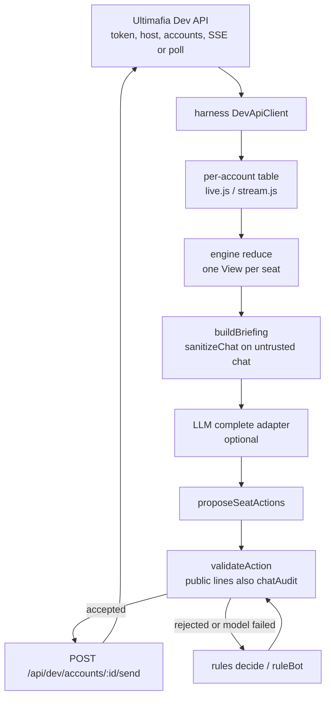

# Mafioso

Mafioso is an AI player for [Ultimafia](https://github.com/UltiMafia/Ultimafia), a real-time, text-based mafia / werewolf game. It is a hybrid:

- **`engine/`** is a deterministic rules engine and state tracker. It has no network code. It folds game events into a per-seat view, decides what that seat may legally do, and rejects anything else.
- **`harness/`** connects to a development Ultimafia server over the Developer API (HTTPS and server-sent events, not the site's raw game socket), asks an LLM for chat and deductions, and sends an action only after the engine accepts it.

A model proposes. The engine validates. If the model fails, returns bad JSON, or proposes something illegal, the seat falls back to the rules policy.

The setup this tree plays is **Frontier Justice**: three Villagers, a Cop, a Journalist, a Sheriff, a Mafioso, a Janitor, and a Lawyer. Role text lives in `engine/data/frontier-justice.json`.

## Architecture



Each Dev API account has its own view, notes, fact ledger, beliefs, and digest. Seats do not read each other's memory. Mafia seats learn a plan only from faction chat the game delivered to that seat.

### What the engine checks before a send

`proposeSeatActions` (`engine/src/llmDecide.js`) is the decision path:

1. The speech scheduler decides whether this seat talks in public. Votes and night actions are not held for that decision.
2. When a `complete` function is injected, the seat asks once for several different options on each open decision (day vote, night target, whether to claim, and a speech goal only if the scheduler already said speak).
3. `selectAction` drops options `validateAction` rejects, applies hard rules, and samples the rest with a seeded softmax. Hard rules include: act on an open night ability; do not kill or vote a known teammate; town does not vote a player it reads as town at probability 0.8 or higher unless that vote would tip the lynch; a PLAN line this seat has seen wins while that target is still legal; a Loyal Lawyer litigates teammates; the Janitor cleans the planned kill and does not skip.
4. If that call fails or no legal vote remains, `llmDecide` asks for one JSON action. If that also fails, the seat uses rules `decide`.
5. Public speech, when the scheduler allows it, is generated from the same briefing and checked again. `wait` is rejected while a night ability or a faction night vote is still open.
6. Every action in the returned list has passed `validateAction`.

`DevApiClient.send` runs `validateAction` again and throws `IllegalActionError` before any HTTP when a view is provided. `runLoop` / `runLoopAsync` collect proposals and do not send.

`legal.js` keeps three layers apart: what the Ultimafia server accepts, hard rules `validateAction` refuses, and advice a bot should not pick. Vote Kick is refused. A town seat cannot vote no-one into an autoloss, on day 1 while the Sheriff lives, or under a day meteor.

### Untrusted chat

Player chat is data, not instructions.

- `sanitize.js` normalizes text (NFKC, strips invisible format characters), flattens it to one line, caps it, defangs injection markers, and JSON-quotes it (`sanitizeChat`).
- `buildBriefing` puts the last messages under `PLAYERS SAID (untrusted, quoted)` and quotes names the same way. Faction chat in NOTES is quoted too.
- `SYSTEM_PROMPT` tells the model that block is untrusted and that the reply must be one JSON action from `LEGAL ACTIONS`.
- `validateAction` rejects public or faction speech that contains machine coordination (`PLAN`, `key=value`, raw player ids, invisible characters) and public speech that admits a mafia faction, names a teammate as team, or fails `chatAudit`.
- `chatAudit` checks a public line against what this seat knows. Flags are `LEAK` (hidden info), `CONTRADICTION` (a public fact stated wrong), and `SCUM_MISTAKE` (a fake claim or result the public facts already disprove). Deception that still fits the public facts is allowed. `view.config.chatAudit === "measure"` records flags and does not block. The default on the live table and in self-play is `enforce`.

Case notes for the injection tests are in `harness/test/INJECTION_CASES.md`.

## How a game flows

Live entry point: `harness/scripts/live.mjs` → `runLiveCli`.

1. **Dry run.** If `MAFIOSO_LIVE` is not `1`, the process logs one dry-run line and returns. It does not call fetch.
2. **Allowlist.** `DEV_HOSTS` in `engine/src/types.js` is `https://dev.ultimafia.gg` and `http://127.0.0.1:3000`. Any other origin throws `HostNotAllowedError` on the client and again on each request. `DEV_API_BASE_URL` defaults to `https://dev.ultimafia.gg`.
3. **Auth.** `POST /api/dev/token` with `DEV_API_CLIENT_ID` and `DEV_API_CLIENT_SECRET`. The Bearer token is refreshed on a 55-minute timer, including before each stream connect. Optional Cloudflare Access headers (`CF_ACCESS_CLIENT_ID`, `CF_ACCESS_CLIENT_SECRET`) are added only to game fetches.
4. **Lobby.** `hostGame` forces `private: true`, `lobby: "Testing"`, and `spectating: true`, and refuses ranked or competitive. `DEV_SETUP_ID` is required to host. `GAME_ID` joins a game that is already open. `createAccounts` seats `BOT_COUNT` test accounts (default 9, range 1–50). When this process hosted, it then leaves the developer's own seat so the developer does not take a player slot.
5. **Self ids.** The server sends `self` once, often before the stream attaches. `seedSelfIds` reads each account's `playerId` from `GET /api/dev/accounts`. Without a self id the seat decides nothing.
6. **Events.** `MAFIOSO_TRANSPORT=stream` (default) reads `GET /api/dev/stream` (`event: game`, data `{accountId, seq, t, event, data}`). `poll` reads `GET /api/dev/accounts/:id/events?since=`. `DEV_STREAM_PATH` must stay under `/api/dev/`. Reconnect uses exponential backoff. After each subscribe the harness backfills buffered events and drops sequence numbers it has already applied. `docs/PROTOCOL.md` is the frame catalog; `harness/test/protocol-doc.test.js` checks it against the fixtures and `classifyEvent`.
7. **Reduce.** Each account's frames fold into its own `View`: players, phase, meetings, votes, messages, reveals, claims, notes, and the seat memory. A new `state` clears meetings. `history` restores the current state's meetings, dead players, and winners on reconnect.
8. **Phases.** `state.name` is `Pregame`, `Day N`, or `Night N`.
   - **Night.** Mafia chat, Mafia Kill, and the role meetings the server opens: Cop Investigate (`Learn Alignment`), Journalist Receive Reports, Lawyer Litigate, Janitor Clean Death (Yes/No, once). The offline resolver in `engine/src/resolve.js` applies them in server priority order: a Doctor save (not part of the Frontier Justice deal), then Litigate, then Clean Death when the kill will land, then the Mafia kill, then Cop and Journalist reports. A killed seat still acts that night.
   - **Day.** Village lynch vote, and the Sheriff's Shoot Gun when the gun is still loaded. The gun is instant and single use. The shot reveals the shooter. The village tally counts every ballot, including no-one (`*`); a tie kills nobody.
9. **Decide and send.** One queue per seat. A limiter caps concurrent model calls (1 for LM Studio, 4 otherwise, or `MAFIOSO_LLM_CONCURRENCY`). `client.send` posts only actions that pass `validateAction`. Log lines pass through `redact` for the credential and key environment values.
10. **After the game.** `winners` / `finished` end the loop. If evolving is on, each prompt that played is scored and the model is asked for a child system prompt. The child is stored only when it still contains the never-admit-AI line and the JSON action contract (`"vote"|"unvote"|"speak"|"wait"`). `MAFIOSO_ARENA_GAMES` above 0 also requires an offline arena on the same seeds to beat the parent by more than the noise. The runtime store is `harness/data/prompts/runtime/` (gitignored). The committed seed is `harness/data/prompts/seed.json`.

The harness does not open the website session cookie or the raw `auth` / `join` game socket. `engine/src/wire.js` is the raw frame codec, kept for reference. It is not the live transport.

## Frontier Justice roles

Dealt by the arena and by self-play (`FJ_ROLES`): Villager, Villager, Villager, Cop, Journalist, Sheriff, Mafioso, Janitor, Lawyer.

Alignments in `engine/src/faction.js`: Villager, Cop, Journalist, and Sheriff are Village. Mafioso, Janitor, Lawyer, and Loyal Lawyer are Mafia. Allies come from the server reveal and the harness-injected teammate roster. A claim is never an ally.

`winnerOf` in `engine/src/resolve.js`: Village wins when every living player is Village. Mafia wins when living Mafia is at least half the living players. An empty town, or the meteor stalemate, is "No one".

The cards in `engine/data/frontier-justice.json` are guidance in the briefing. They do not replace `validateAction`.

| Role | What the card and the resolver model |
| --- | --- |
| Villager | No night action. Claim Villager (the card says "villager" or "blue"). Follow a living Sheriff and a confirmed Cop. A Cop guilty is hard because a Loyal Lawyer cannot frame town. A Cop innocent is soft. |
| Cop | Night meeting Investigate. Must vote a living player while the meeting is open (`data/night-actions.json`, `alwaysAct`). Guilty means the target appears non-Village after litigation. The card says to put the result on the same line as the claim once the Sheriff is alive and has claimed. |
| Journalist | Night meeting Receive Reports: the reports the target got that night, or none. The card says to read the Cop on night 2, and that a target with no report is a fake Cop. |
| Sheriff | One day gun (Shoot Gun). No visit. The card says to shoot on day 1. `sheriffGate.js` also has an `evidence` rule used by self-play (`--sheriff-rule`). The shot reveals the Sheriff, so a Sheriff counterclaim is refused. |
| Mafioso | Vanilla Mafia. Looks guilty to the Cop unless the Lawyer litigates them. Kill priority in the card and in `MAFIA_KILL_PRIORITY`: Cop, then Sheriff, then Journalist. Coordinate in Mafia chat with names. `PLAN`, `key=value`, and raw ids are illegal in every meeting. |
| Janitor | Clean Death once. The clean hides the flip and the Janitor learns the role. The card says to clean the night 1 kill and to pass the cleaned role with a short code in Mafia chat, not by naming the role in town. |
| Lawyer | Loyal. Litigate only reaches teammates in the loyal model: a visit on town is blocked, and a teammate then appears Village to the Cop. The card says to litigate the Mafioso unless the counterclaim plan says otherwise. |

`engine/data/night-actions.json` also lists night policies for roles outside this setup (Doctor, Tracker, and others). Those entries do not add seats to Frontier Justice.

Live mafia behavior comes from `createBotTable`, which sets `mafia: "adaptive"` (`engine/src/adaptiveMafia.js`): kill priority from public claims, varied fake claims, the Janitor holding its one clean for a claimed power role or a late night, and day votes that do not pile three scum onto one wagon. The engine's own `decide` stays on the scripted plan unless `view.config.mafia` is `"adaptive"`. Self-play defaults to adaptive; `--mafia script` restores the fixed plan.

## Module map

### Engine (`engine/src/`)

| Module | Role |
| --- | --- |
| `types.js` | View shapes, `DEV_HOSTS`, speech length, no-one (`*`) |
| `wire.js` | Raw socket frame codec. Not the live transport |
| `reducer.js` | `emptyView`, `reduce`, handled and ignored event lists |
| `legal.js` | Meeting definitions, `legalVotes`, `validateAction`, leak checks |
| `decide.js` | Rules policy. Always returns actions that validate |
| `nightAct.js` | Forced night votes from `data/night-actions.json` |
| `claims.js` | Regex claims, counterclaims, and retracts |
| `faction.js` | Alignment, allies, enemies |
| `notes.js` | Checks, deaths, votes, and parsed server alerts |
| `factLedger.js`, `beliefs.js`, `digest.js`, `memory.js` | Per-seat facts, reads, and a rolling summary |
| `scumPlan.js` | Plan parsed from faction chat this seat has seen |
| `adaptiveMafia.js` | Public-info mafia plan used when the seat is in adaptive mode |
| `roleGuide.js` | This seat's Frontier Justice card in the briefing |
| `scheduler.js` | Whether this seat speaks in public, plus cooldown and rate cap |
| `candidates.js`, `selector.js` | Several model options, then hard rules and a seeded pick |
| `llmDecide.js` | Briefing, JSON parse, `proposeSeatActions`, `SYSTEM_PROMPT` |
| `sanitize.js` | Defang and quote untrusted text |
| `chatAudit.js` | Ground public lines in this seat's view |
| `chatStyle.js` | Length, claim wording, pressure, repeated lines |
| `speechNames.js`, `speechFacts.js` | Names and facts a public line may use |
| `sheriffGate.js`, `sheriffAsk.js` | Gun timing and claim asks |
| `hammer.js`, `ballot.js` | Revealed-Sheriff hammer ask, and the village ballot |
| `townReads.js`, `townVote.js` | Town reads from public evidence, and the day vote |
| `bus.js` | When scum may vote a teammate in the village |
| `lynchMath.js` | Parity, lynch-or-lose, meteor, day-1 lynch owed |
| `quietTable.js` | Optional quiet-table speech variants (off unless configured) |
| `ruleBot.js` | Fixed baseline seat. No model |
| `resolve.js` | Pure night/day resolution for the core roles |
| `metrics.js` | `scoreGame` and pooled rates with Wilson intervals |
| `jsonText.js` | Pull one JSON object out of a model reply |

`engine/src/index.js` re-exports the public surface. `harness` depends on it with `"mafioso-engine": "file:../engine"`.

### Harness (`harness/src/`)

| Module | Role |
| --- | --- |
| `client.js` | Dev API client. Injected `fetch`. Host allowlist. `send` validates first |
| `stream.js` | SSE parse, per-account replay, `runLoop` / `runLoopAsync` (never send) |
| `live.js` | Multi-seat table, pacing, and `runLiveCli` |
| `clock.js` | Wall clock and a virtual clock for tests and self-play |
| `openaiCompatible.js` | Shared `POST {base}/chat/completions` client. Not the game API |
| `lmstudio.js`, `experiential.js`, `opencodeGo.js`, `openrouter.js` | Backend factories |
| `prompts.js` | Seed prompt, epsilon-greedy selection, evolve gate |
| `arena.js` | Offline Frontier Justice. RuleBot mixed with model seats. No socket |
| `selfplay.js` | Offline Frontier Justice on the live decision path. No model and no socket |
| `replayBuild.js` | Rebuild sanitized protocol fixtures from live-harness logs |
| `auditPlant.js` | Test-only planted lines for the chat audit |
| `simLatency.js` | Replay logged model latencies. Reads `latency-live1018.json` |
| `latency-live1018.json` | Service times and reject counts for that simulator. No ids and no chat text |

### Scripts (`harness/scripts/`)

| Script | What it does |
| --- | --- |
| `live.mjs` | One private Testing game, or a dry run |
| `arena.mjs` | Offline arena, write `logs/replays/`, optional summary |
| `selfplay.mjs` | Offline self-play, write `logs/selfplay/` |
| `lmstudio-smoke.mjs` | One local LM Studio completion. Not part of `npm test` |
| `build-replays.mjs` | Build sanitized fixtures from log files |
| `audit-rejects.mjs` | Replay logged rejected lines through the current validators |
| `sheriff-eval.mjs` | Count Sheriff shots and asks in `*.games.jsonl` |
| `stale-latency.mjs` | Split stale speech rejects out of a live log |

### Docs

| File | What it is |
| --- | --- |
| `docs/PROTOCOL.md` | Frames the harness handles, checked by `protocol-doc.test.js` |
| `docs/protocol-map.md` | Earlier notes from the Ultimafia client and the Dev API |
| `docs/prior-bots.md` | Notes on `UM-Autobot-Player` and `claude-um-bot-1` |
| `harness/selfplay/NOTES.md` | Historical self-play tuning notes |
| `harness/test/INJECTION_CASES.md` | Injection cases the tests cover |

## Configuration

Secrets stay in the environment. `.env.example` lists placeholders. Copy it to `.env` locally. `.env` and `.env.*` are gitignored, except `.env.example`.

`MAFIOSO_LLM` selects the factory: `lmstudio` (default), `experiential`, `opencode`, or `openrouter`. Aliases `lm-studio`, `explabs`, `opencode-go` are accepted. Every backend returns `complete({system, user})`. The reply is still parsed and passed through `validateAction`.

They share `createOpenAICompatibleComplete`: `POST {baseUrl}/chat/completions`, `stream: false`, and `response_format: { type: "json_object" }`. If the server rejects `response_format`, the client retries once without it. `temperature` and `max_tokens` are sent only when you pass finite numbers. This client does not use `DEV_HOSTS`.

| Backend | Factory | Base URL default | Key variable | Model variable |
| --- | --- | --- | --- | --- |
| LM Studio | `createLmStudioComplete` | `http://127.0.0.1:1234/v1` | `LM_API_KEY` (default placeholder `lm-studio`) | `LM_STUDIO_MODEL` (empty discovers the first id) |
| Experiential Labs | `createExperientialComplete` | `https://api.experientiallabs.ai/v1` | `EXPLABS_API_KEY` | `EXPLABS_MODEL` |
| OpenCode Go | `createOpenCodeGoComplete` | `https://opencode.ai/zen/go/v1` | `OPENCODE_API_KEY` | `OPENCODE_MODEL` |
| OpenRouter | `createOpenRouterComplete` | `https://openrouter.ai/api/v1` | `OPENROUTER_API_KEY` | `OPENROUTER_MODEL` (default `minimax/minimax-m3.1-flash`) |

Optional base overrides: `LM_STUDIO_BASE_URL`, `EXPLABS_BASE_URL`, `OPENCODE_BASE_URL`, `OPENROUTER_BASE_URL`. OpenCode Go also reads `OPENCODE_SESSION` and sends `user-agent: mafioso/0.1`. OpenRouter sends `HTTP-Referer` and `X-Title` only when `OPENROUTER_HTTP_REFERER` and `OPENROUTER_TITLE` are set. `EXPLABS_ZDR=1` adds `provider.zdr` on that backend.

### Environment variables

Names only. Defaults in parentheses come from the code.

**Game connection**

`MAFIOSO_LIVE` (connect only when `1`), `DEV_API_BASE_URL`, `DEV_API_CLIENT_ID`, `DEV_API_CLIENT_SECRET`, `DEV_SETUP_ID`, `GAME_ID`, `BOT_COUNT` (`9`), `LOBBY_NAME` (`mafioso-bots`), `MAFIOSO_TRANSPORT` (`stream` or `poll`), `DEV_STREAM_PATH`, `CF_ACCESS_CLIENT_ID`, `CF_ACCESS_CLIENT_SECRET`.

**Model and prompts**

`MAFIOSO_LLM` (`lmstudio`), `MAFIOSO_LLM_CONCURRENCY`, `MAFIOSO_REASONING`, `MAFIOSO_EVOLVE` (off when `0`), `MAFIOSO_PROMPT_DIR`, `PROMPT_EPSILON` (`0.2`), `PROMPT_TEMPERATURE` (`0.5`), `MAFIOSO_ARENA_GAMES` (`0`), `MAFIOSO_ARENA_SEED` (`1`), `MAFIOSO_ARENA_MARGIN` (`0`).

**Seat strategy for one live process**

`MAFIOSO_TOWN` (`rules`, `suspicion`, or `random`), `MAFIOSO_HAMMER` (off when `0`, `off`, `false`, or `no`).

**Model backends**

`LM_STUDIO_BASE_URL`, `LM_STUDIO_MODEL`, `LM_API_KEY`, `EXPLABS_BASE_URL`, `EXPLABS_MODEL`, `EXPLABS_API_KEY`, `EXPLABS_ZDR`, `OPENCODE_BASE_URL`, `OPENCODE_MODEL`, `OPENCODE_API_KEY`, `OPENCODE_SESSION`, `OPENROUTER_BASE_URL`, `OPENROUTER_MODEL`, `OPENROUTER_API_KEY`, `OPENROUTER_HTTP_REFERER`, `OPENROUTER_TITLE`.

### CLI flags

`live.mjs` and `lmstudio-smoke.mjs` take no flags. They read the environment.

`arena.mjs`: `--games`, `--seed`, `--mafioso`, `--days`, `--file`, `--summary`, `--quiet`, `--live`, `--base`, `--lobby`, `--private`. `--live` checks the dev allowlist and a private Testing lobby, then refuses to open a socket.

`selfplay.mjs`: `--games`, `--seed`, `--days`, `--out`, `--quiet`, `--cop-rule` (`vinman` or `wait`), `--sheriff-rule` (`vinman` or `evidence`), `--lawyer` (`loyal` or `plain`), `--mafia` (`adaptive` or `script`), `--town` (`rules`, `suspicion`, or `random`), `--chat-audit` (`enforce` or `measure`), `--audit-tight` (`on` or `off`), `--stale-votes` (`clear` or `server`), `--hammer` (`on` or `off`), `--hammer-gate`, `--qt-filler`, `--qt-repair`, `--qt-keyfirst`, `--claim-pressure`, `--plant-audit`, `--sim-latency`, `--stale-recheck`, `--stale-cancel`, `--stale-fallback`.

`build-replays.mjs` takes an output directory and log paths. `audit-rejects.mjs` takes a fixture directory and optional `--json`, `--engine`. `sheriff-eval.mjs` takes one directory per arm. `stale-latency.mjs` takes log paths and optional `--json`, `--dist`.

## Running

Node 18 or newer. The Docker image is Node 22. Tests use `node:test` and a fake model. They do not need API keys.

```bash
cd engine && npm test
cd ../harness && npm install && npm test
```

`harness` must be installed once so `mafioso-engine` resolves. `engine` has no dependencies.

### Tests, fixtures, replays

- Engine fixtures: `engine/test/fixtures/` (`*.jsonl`, `claims.json`, `real-alerts.json`).
- Protocol replays: `harness/test/fixtures/replays/` (`g01`–`g16` plus `manifest.json`). Ids and names in those fixtures are replacements, not the raw logs.
- Live-shaped fixtures: `harness/test/fixtures/live-1018/`.
- A sample SSE body: `harness/test/fixtures/stream.sse`.
- Rebuild fixtures from a live log (offline): `node scripts/build-replays.mjs <out-dir> <log>...` from `harness/`. The builder replaces ids and names and throws if a raw id or name remains.

### Self-play and arena

Both stay on this machine. They do not open a socket and do not call Ultimafia.

```bash
cd harness
npm run selfplay -- --games 50 --seed 1
npm run arena -- --games 4 --seed 1 --mafioso 3 --summary
node scripts/arena.mjs --summary --file ../logs/replays/arena-1.jsonl
```

Self-play writes `logs/selfplay/selfplay-seed<seed>-n<games>...` as `.json`, `.md`, `.records.jsonl`, and `.games.jsonl`. The arena writes `logs/replays/arena-<seed>.jsonl`. Those directories are gitignored apart from a `.gitkeep`. The process exits 1 when a self-play game records an illegal action or an error.

`harness/selfplay/NOTES.md` is a historical tuning note. It is not a fresh scorecard.

### Live run against a dev instance

From `harness/`:

```bash
node scripts/live.mjs
```

With `MAFIOSO_LIVE` unset, that prints a dry run and exits. A real session needs `MAFIOSO_LIVE=1`, a base URL on `DEV_HOSTS`, `DEV_API_CLIENT_ID`, `DEV_API_CLIENT_SECRET`, and `DEV_SETUP_ID` (or `GAME_ID`). Put those in `.env`. Do not commit it.

Local LM Studio smoke (talks to the model, not to Ultimafia):

```bash
cd harness && node scripts/lmstudio-smoke.mjs
```

### Docker

`Dockerfile` and `docker-compose.yml` run the live script.

- `docker compose up --build` builds the `bots` service. Compose defaults `MAFIOSO_LIVE` to `0`, so the container dry-runs until `.env` turns it on. LM Studio is reached at `host.docker.internal` from Docker Desktop.
- `docker compose up --build vps` is the host-network service (`profiles: ["vps"]`). Its default base URL is `http://127.0.0.1:3000`, for a Dev API already listening on that machine. The profile keeps a plain `up` from starting host networking.

The image copies `engine/` and `harness/`, installs production dependencies, and runs `node scripts/live.mjs`. Prompt history is mounted at `harness/data/prompts/runtime`. The image does not copy `.env`; Compose reads it via `env_file`.

This repository has no Apple container config.

## Safety

- Live mode is off unless `MAFIOSO_LIVE=1`.
- The client talks only to `DEV_HOSTS`. A production host is rejected with `HostNotAllowedError`. There is no flag in this tree that switches the client onto a public lobby.
- `hostGame` forces a private Testing lobby and refuses ranked or competitive games.
- `docs/prior-bots.md` records the project rule that a production or public game still needs the owner's explicit yes.
- Credentials and model keys are environment variables. `runLiveCli` redacts those values in log lines. `DevApiClient.api` does not echo request bodies.
- Do not commit `.env`, tokens, or live logs. `logs/replays/` and `logs/selfplay/` are gitignored. The prompt runtime directory is gitignored.
- The arena's `--live` path checks the allowlist and then still does not open a socket.

## License

PolyForm Noncommercial License 1.0.0. The text is in [`LICENSE`](LICENSE).

Required Notice: Copyright (c) 2026 Vincent Deriu

Both packages set `"license": "PolyForm-Noncommercial-1.0.0"`.

`engine/src/wire.js` carries an in-file note that it was copied from UM-Autobot-Player (`src/wire.js`, MIT). Ultimafia itself is a separate project and is not vendored here.

Noncommercial use is what that license allows. Read the license before you distribute copies or build on this tree.
